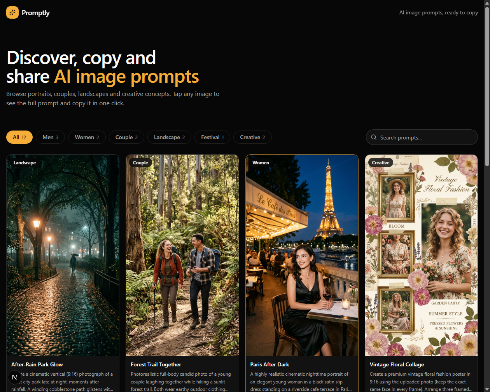

# Promptly

Promptly is a responsive gallery of ready-to-use AI image prompts. Browse examples
for portraits, couples, landscapes, festivals, and creative concepts; filter or
search the collection; then open a card to read and copy its full prompt.

## Screenshot



## Features

- Masonry-style image gallery with 12 bundled prompt examples.
- Category filters for Men, Women, Couple, Landscape, Festival, and Creative.
- Search across prompt titles, prompt text, and tags.
- Detail dialog with a larger image, category, tags, and full prompt.
- One-click prompt copying with a visible confirmation.
- Responsive layout and keyboard-accessible controls.
- Locally bundled sample images; no external image service or API is required.

## Tech stack

- [Next.js](https://nextjs.org/) 16 with the App Router
- [React](https://react.dev/) 19 and TypeScript
- [Tailwind CSS](https://tailwindcss.com/) 4
- [Base UI](https://base-ui.com/) dialog primitives and [Lucide](https://lucide.dev/) icons

## Getting started

### Prerequisites

- Node.js 20.9 or newer
- pnpm (the package manager specified by this project)

### Run locally

```bash
pnpm install
pnpm dev
```

Open [http://localhost:3000](http://localhost:3000) in your browser.

### Build for production

```bash
pnpm build
pnpm start
```

## Project structure

```text
app/
  globals.css       Global styles and theme tokens
  layout.tsx        Root layout, metadata, and analytics
  page.tsx          Gallery landing page
components/
  prompt-card.tsx   Individual prompt preview
  prompt-dialog.tsx Full prompt detail and copy action
  prompt-gallery.tsx Search, category filters, and gallery state
  site-header.tsx   Sticky Promptly header
  ui/               Shared UI components
lib/
  prompts.ts        Prompt examples, categories, and types
  utils.ts          Shared utility helpers
public/
  prompts/          Gallery images
  promptly-screenshot.png
```

## Updating the prompt collection

Prompt content and its category/type definitions live in [`lib/prompts.ts`](./lib/prompts.ts).
Add each prompt there and put its image under `public/prompts/`. Use the image's
public URL path (for example, `/prompts/my-image.png`) in the `image` field.

## Available scripts

| Command | Description |
| --- | --- |
| `pnpm dev` | Start the local development server |
| `pnpm build` | Create a production build |
| `pnpm start` | Serve the production build |

Prompt data is currently bundled as a static TypeScript array; the project does
not include a database, authentication, or prompt-generation service.
